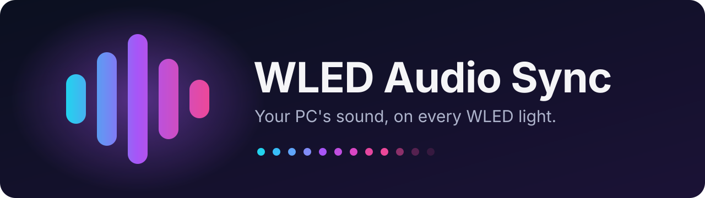

<p align="center">
  
</p>

<p align="center">
  <a href="https://github.com/Advve/wled-audio-sync/actions/workflows/build.yml"></a>
  <a href="https://github.com/Advve/wled-audio-sync/releases/latest"></a>
  <a href="LICENSE"></a>
  <br>
  
  
  
  
</p>

WLED Audio Sync makes your [WLED](https://kno.wled.ge) lights react to whatever your **Windows** or
**Linux** PC is playing: music, games, videos. No microphone needed. It speaks WLED AudioReactive's own
"audio sync" protocol, so every sound-reactive effect works and nothing on the lights needs flashing.

> **Disclaimer:** WLED Audio Sync is an independent project. It is not affiliated with or endorsed by the
> WLED project.

- **One small tray app.** A single file of about 4 MB, nothing to install. Pick the audio source, channel and
  sensitivity from the tray menu; it starts at login if you want.
- **Every light in time.** All your WLED devices receive the *same* audio data and compute their effects
  themselves, so they pulse together.
- **Made for PC audio.** Clean digital audio has far more bass than the small microphones WLED is tuned for.
  Per-band automatic gain lets vocals, synths and hi-hats drive the lights, not just the kick drum.
- **Gets through home routers.** It broadcasts on your local network instead of using multicast, which
  many routers drop between wired PCs and WiFi devices.
- **Quiet when it should be.** It stops sending after a second of silence, so several PCs can share the
  same lights: whichever one is playing drives them.
- **English and Polish,** picked automatically from your system.

## Install

- **Windows 10/11:** download `wled-audio-sync.exe` from the [latest release](https://github.com/Advve/wled-audio-sync/releases/latest).
  - Put it somewhere permanent, e.g. `%LOCALAPPDATA%\Programs\WLED Audio Sync\`, and start it. A sound-wave
    icon appears in the tray (check the **^** overflow area).
  - It isn't code-signed yet, so SmartScreen may warn the first time: **More info → Run anyway**. With
    *Smart App Control* switched on, Windows blocks unsigned apps completely.
  - Right-click the icon → **Start at login**. If you move the file later, start it once from the new place
    and it updates the startup entry itself.
- **Linux:** download `wled-audio-sync-linux-amd64` (or `-arm64` for e.g. a Raspberry Pi 4/5) and install it:
  ```bash
  install -m 755 wled-audio-sync-linux-amd64 ~/.local/bin/wled-audio-sync
  ~/.local/bin/wled-audio-sync
  ```
  - Needs PulseAudio or PipeWire. The tray icon uses StatusNotifier: KDE, Xfce, Cinnamon and Ubuntu show it;
    plain GNOME needs the *AppIndicator and KStatusNotifierItem Support* extension.
  - No tray or no desktop? `wled-audio-sync --no-tray` runs in the terminal with a live meter.

## Set up your WLED lights

On each light's web page → **Config**:

1. **Usermods → AudioReactive:** tick **Enabled**, set **Sync → Mode: Receive**, port **11988**. No
   microphone is needed. The standard ESP32 builds of WLED include AudioReactive.
2. **WiFi Setup:** tick **Disable WiFi sleep**, so effects react smoothly.
3. On the main page, pick a sound-reactive effect (marked ♪), e.g. *Freqwave*, *Gravcentric* or *DJ Light*.

Play something: the tray icon turns colourful and the lights follow the music.

For a complete setup, see the [synced lamps example](examples/synced-lamps/): two lamps that mirror each
other, touch-button control, and ready-made light and music presets for any WLED device. The
[pole lamp example](examples/pole-lamp/) adds 19 music modes for a tall 60-LED strip.

## Using it

The tray menu:

- **Pause:** stop sending; the lights go quiet in sound-reactive effects.
- **Audio source:** *Default output* (follows when you switch, e.g. to headphones) or a specific device.
- **Channel:** the sync port, 11988 (default) to 11991. Give two groups of lights different ports, set the
  same channel on two PCs, and each PC drives its own lights.
- **Sensitivity:** Low, Normal, High or Very high.
- **Language:** Automatic, English or Polski.
- **Start at login** and **Open log.**

The icon shows the state: a gradient wave while sending, a plain wave while idle, a dimmed wave when paused,
and a red dot when something's wrong (the menu says what). It follows your taskbar's dark or light theme.
Only one copy runs at a time; starting it again just says it's already running.

Command-line options, mainly for troubleshooting (`--help` lists them all):

- `--no-tray` runs in the terminal with a live meter; `--list` lists output devices; `--listen` shows the
  audio-sync packets arriving on this PC; `--version` prints the version.
- `--interface 192.168.1.23` broadcasts on the network where this PC has that IP, e.g. when a VPN or a
  WSL/Hyper-V adapter takes over the automatic choice.
- `--unicast 192.168.1.50,192.168.1.51` also sends straight to those lights (e.g. on another subnet);
  `--multicast` also sends to WLED's standard multicast group.
- `--device`, `--port`, `--gain`, `--beat`, `--squelch`, `--lang` override the menu settings for one run.

Settings live in `%APPDATA%\wled-audio-sync\` or `~/.config/wled-audio-sync/`, next to the log file.

If a light doesn't react: check it's on a ♪ effect and AudioReactive is set to **Receive** on the same port
as the app's **Channel**. The light's info panel (ⓘ) shows *UDP sound sync - receiving* when packets
arrive. If it says *idle* while the tray icon is colourful, the PC and the light aren't on the same network,
or a VPN took over (use `--interface`).

## How it works

```
capture_windows.go   WASAPI loopback: records what an output device plays
capture_linux.go     the same from the PulseAudio / PipeWire monitor
ring.go              the last 2048 samples, shared between capture and analysis
analyzer.go, fft.go  volume, 16 frequency bands, beat detection, dominant pitch, automatic gain
packet.go            WLED AudioReactive's "audio sync v2" packet (44 bytes)
network.go           broadcast (default), multicast and unicast sending
engine.go            runs it all 50 times per second; stops sending when silent
tray.go, icon.go     the tray menu and its icon, drawn in code
```

The app never sends the sound itself, only the analysis: two volume levels, a beat flag, 16 band levels,
the dominant frequency and its strength. That's about 2 KB/s, only while something plays, and broadcasts
never leave your local network. WLED's AudioReactive receiver accepts the packets by broadcast, multicast
or unicast. The band layout follows WLED's `usermods/audioreactive/audio_reactive.cpp`.

## Develop

Requirements: [Go](https://go.dev/dl/) 1.27 or newer. Everything is pure Go, so one machine builds every
version.

```bash
go vet ./... && go test ./...      # vet and test
GOOS=linux go vet ./...            # also vet the Linux-only files
go run . --no-tray                 # run with a live meter instead of the tray
go generate ./...                  # after changing the icon or winres/winres.json
go run ./tools/notices             # after changing dependencies (CI checks it)
```

```bash
CGO_ENABLED=0 GOOS=windows go build -trimpath -ldflags "-s -w -H=windowsgui" -o dist/wled-audio-sync.exe .
CGO_ENABLED=0 GOOS=linux GOARCH=amd64 go build -trimpath -ldflags "-s -w" -o dist/wled-audio-sync-linux-amd64 .
CGO_ENABLED=0 GOOS=linux GOARCH=arm64 go build -trimpath -ldflags "-s -w" -o dist/wled-audio-sync-linux-arm64 .
```

Translations live in `i18n.go`, one line per text with English and Polish side by side. The tray and
`.exe` icons are drawn by `icon.go`; `go generate` embeds the `.exe` icon and version info via
[go-winres](https://github.com/tc-hib/go-winres).

## Releasing

1. Set the new version in `version.go` and `winres/winres.json` (the four version fields), then run
   `go generate ./...` so the `.exe` properties match.
2. Add a `- **X.Y.Z** ...` entry at the top of the changelog below, and check everything agrees:
   `go run ./tools/release --check X.Y.Z`.
3. Commit, then tag and push:
   ```bash
   git tag vX.Y.Z
   git push origin vX.Y.Z
   ```

CI tests and builds every push. On a version tag it also checks the tag against the version and the
changelog, then publishes **WLED Audio Sync X.Y.Z** with the three downloads, `SHA256SUMS.txt`,
`THIRD-PARTY-NOTICES.txt` and release notes taken from the changelog.

## Changelog

- **1.0.0** (first release), a tray app for Windows and Linux that sends your PC's audio to WLED lights
  - Captures the system's audio output (WASAPI loopback, PulseAudio/PipeWire monitor); no microphone needed
  - WLED AudioReactive audio sync v2, broadcast on the local network 50 times per second; stops when silent
  - Analysis tuned for PC audio: per-band automatic gain, contrast, beat detection, melody-following pitch
  - Tray menu with audio source, channel, sensitivity, pause, language and start at login
  - Icon follows the taskbar's dark/light theme; the Windows menu follows dark mode
  - English and Polish, picked from the system
  - Runs once per user; `--no-tray`, `--list`, `--listen` and more for troubleshooting
  - Example WLED presets for two synced lamps with touch-button control

## License

[MIT](LICENSE) © 2026 Adve. The app includes open-source libraries; their licenses are in
[`THIRD-PARTY-NOTICES.txt`](THIRD-PARTY-NOTICES.txt), regenerated with `go run ./tools/notices`.
